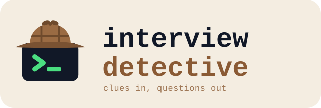

<p align="center">
  
</p>

Detective work before a job interview, run by Claude Code. You say what company, role and round; it
investigates in parallel and hands back a sourced report with the questions you are most likely to get.

- **Glassdoor**: scrapes the company's interview reviews for related roles into JSON you can query,
  grouped by how close each role is to yours. You log in once in a browser window it opens on its own
  workspace; it never takes your focus.
- **GitHub and the web**: the company's repos and stack, public work by people who work there, prep
  repos and take-home solutions past candidates uploaded, write-ups, talks, archived job posts.
- **Question check**: is each question a standard problem, a variant of one, or specific to this
  company, with a link to practise on.
- **Report**: summary, findings with sources and confidence, Glassdoor numbers, practice questions.

## Get started

You need [Claude Code](https://claude.com/claude-code), [uv](https://docs.astral.sh/uv/), Chromium,
and the [`gh`](https://cli.github.com/) CLI, logged in. The setup wizard checks for each.

1. Install the plugin from the [ah-merii marketplace](https://github.com/AH-Merii/claude-plugins), in
   Claude Code:

   ```text
   /plugin marketplace add AH-Merii/claude-plugins
   /plugin install interview-detective@ah-merii
   ```

2. Run the setup wizard in a terminal. `/interview-detective:setup` prints the command with the
   plugin's path filled in; it looks like this:

   ```bash
   bash ~/.claude/plugins/cache/ah-merii/interview-detective/<version>/setup/wizard.sh
   ```

   It checks the requirements and asks where your cases should live (`~/interview-detective` by
   default). On [niri](https://github.com/YaLTeR/niri) it checks for the window rule that keeps the
   browser from taking your focus. If niri doesn't load that rule yet, the wizard shows it and offers to
   add it, once you approve, to `~/.config/niri/cfg/agents.kdl`, the file for rules made for agents.
   It uses an `agents.kdl` your config already includes, if there is one, and you can name another file.
   It also adds the `include` line to `config.kdl` if it's missing. If `niri validate` rejects the
   result, both files go back to how they were. Then it opens the browser once to check it, and offers
   a Glassdoor login. Run it again any time: anything already in place is left alone.

3. In Claude Code, from any folder, run `/interview-detective:interview-detective` or say you have an
   interview coming up.

## What a run looks like

1. **Intake.** It asks for the company, role and round, and what you already have: emails, a job post,
   a take-home. It writes `<case>/01_intake/intake.md` in your cases folder; read it, fix anything wrong, and say
   it's right.
2. **Research and Glassdoor, at the same time.** Agents search GitHub and the web in the background.
   A Chromium window opens on a new workspace called `interview-detective` on your current screen;
   switch to it, log in to Glassdoor and clear any Cloudflare check, then tell Claude. If research hits
   pages behind a captcha or login, they open as more tabs there for you to clear.
3. **Question check.** Every reported question is matched to a standard problem, a variant, or marked
   as specific to the company. Star (★) the ones you want the report to favour.
4. **Report.** `<case>/05_report/report.md`: summary, findings with sources, Glassdoor
   numbers and practice questions.

It stops after each stage for you to read what it wrote, and the next stage reads your edits.
Asking for status lists every case and its next stage, and saying "resume" picks one up.

Your Glassdoor login stays in the browser's own profile, in `~/.cache/interview-detective/browser/`.
Deleting that folder deletes it.

## How it works

The workspace is an [ICM](https://arxiv.org/abs/2603.16021) pipeline: folders carry the order, files
carry the state, and each stage's contract says exactly what it reads and writes.

- [CONTEXT.md](CONTEXT.md): the five stages on one screen.
- [The skill](skills/interview-detective/SKILL.md): where everything lives, and where to go next.
- [`_shared/agent-tiers.md`](_shared/agent-tiers.md): which model tier does which job.
- [`_shared/browser.md`](_shared/browser.md): the browser, and handing logins to you.
- [`setup/wizard.sh`](setup/wizard.sh): the first-run setup.

The plugin is the factory: contracts, rules, templates and tools, replaced whole on each update. The
cases are the product, so they live outside it, in the folder the wizard saved to
`~/.config/interview-detective/config.env`. They hold scraped reviews and notes on real people's public
work, and never leave your machine.

## Develop

Checks are [mise](https://mise.jdx.dev/) tasks, and CI runs the same ones (`.github/workflows/ci.yml`):

```bash
mise run setup    # once after cloning: the pre-push secret scan
mise run check    # every check: plugin validation, lint, types, tests with coverage, complexity, secrets, workflows
```

`claude --plugin-dir .` loads the plugin from this folder, to try changes without installing them.

The tests run offline, with Chromium and niri faked (`python3 -m unittest discover -s tests`).
`tests/test_live.py` checks the real Glassdoor; its docstring says how to run it.

Releases are automatic. PR titles follow [Conventional Commits](https://www.conventionalcommits.org/), and
release-please keeps a release PR open that bumps `version.txt`, the plugin's version in
`.claude-plugin/plugin.json` (Claude Code updates a plugin only when that changes) and `CHANGELOG.md`. The
interview-detective-bot App merges it once CI passes, which tags `vX.Y.Z` and publishes the release
(`.github/workflows/release.yml`).

## License

[MIT](LICENSE), copyright 2026 AH-Merii (AbdulHamid Merii).
