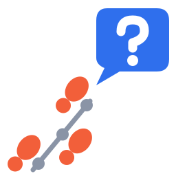

# interview-detective logo concepts: detective motif

Direction: classic detective iconography reinterpreted for code. Each mark avoids the plain "magnifying glass over a document" and ties the detective symbol to code, to interviews, or to both.

Every SVG below is also saved as its own file in this folder: `detective-motif-N.svg` (mark, 256x256) and `detective-motif-N-wordmark.svg` (mark + wordmark, 640x200). All six parse with `xml.dom.minidom` and were rendered with `rsvg-convert` at 256px and 32px to check they still read at small sizes.

The wordmarks use live `<text>` with a font stack, so the exact face depends on the viewer's installed fonts. Convert the text to outlines before treating any of them as final.

| | Brace Print | Prompt Holmes | Commit Trail |
|---|---|---|---|
| Mark |  |  |  |
| Wordmark |  |  |  |

## 1. Brace Print

**Idea:** a fingerprint whose ridges are nested code braces, with an interview question at its core.

**Mark:** two concentric `{ }` pairs form the ridges of a fingerprint. The brace tips stand in for the ridge whorls, and a break in the outer right ridge keeps it from looking like plain symmetric brackets. At the centre, where a fingerprint's core would be, sits an amber `?`: the evidence comes from code, and what it yields is the questions. Colours: ink navy `#16243A` tile, parchment ridges `#EAE3D2`, amber `#F2A93B` question. Typography: a bold monospace (JetBrains Mono or IBM Plex Mono), with "interview" in parchment and "detective" in amber.

```svg
<svg xmlns="http://www.w3.org/2000/svg" viewBox="0 0 256 256" role="img" aria-label="interview-detective: Brace Print">
  <title>Brace Print</title>
  <rect x="8" y="8" width="240" height="240" rx="52" fill="#16243A"/>
  <g fill="none" stroke="#EAE3D2" stroke-width="14" stroke-linecap="round" stroke-linejoin="round">
    <!-- outer ridge: { } with rx 90, ry 100 -->
    <path d="M118 28 Q38 28 38 78 L38 116 Q38 128 26 128 Q38 128 38 140 L38 178 Q38 228 118 228"/>
    <path d="M138 28 Q218 28 218 78 L218 116 Q218 128 230 128 Q218 128 218 140 L218 160"/>
    <path d="M218 188 Q216 228 150 228"/>
    <!-- middle ridge: rx 62, ry 72 -->
    <path d="M118 56 Q66 56 66 92 L66 116 Q66 128 54 128 Q66 128 66 140 L66 164 Q66 200 118 200"/>
    <path d="M138 56 Q190 56 190 92 L190 116 Q190 128 202 128 Q190 128 190 140 L190 164 Q190 200 138 200"/>
  </g>
  <!-- core: the question -->
  <g fill="none" stroke="#F2A93B" stroke-width="14" stroke-linecap="round" stroke-linejoin="round">
    <path d="M108 110 Q108 88 128 88 Q148 88 148 106 Q148 120 128 126 L128 140"/>
  </g>
  <circle cx="128" cy="166" r="9" fill="#F2A93B"/>
</svg>
```

```svg
<svg xmlns="http://www.w3.org/2000/svg" viewBox="0 0 640 200" role="img" aria-label="interview-detective">
  <title>interview-detective: Brace Print wordmark</title>
  <rect width="640" height="200" rx="28" fill="#16243A"/>
  <g transform="translate(20 20) scale(0.625)">
    <rect x="8" y="8" width="240" height="240" rx="52" fill="#16243A"/>
    <g fill="none" stroke="#EAE3D2" stroke-width="14" stroke-linecap="round" stroke-linejoin="round">
      <!-- outer ridge: { } with rx 90, ry 100 -->
      <path d="M118 28 Q38 28 38 78 L38 116 Q38 128 26 128 Q38 128 38 140 L38 178 Q38 228 118 228"/>
      <path d="M138 28 Q218 28 218 78 L218 116 Q218 128 230 128 Q218 128 218 140 L218 160"/>
      <path d="M218 188 Q216 228 150 228"/>
      <!-- middle ridge: rx 62, ry 72 -->
      <path d="M118 56 Q66 56 66 92 L66 116 Q66 128 54 128 Q66 128 66 140 L66 164 Q66 200 118 200"/>
      <path d="M138 56 Q190 56 190 92 L190 116 Q190 128 202 128 Q190 128 190 140 L190 164 Q190 200 138 200"/>
    </g>
    <!-- core: the question -->
    <g fill="none" stroke="#F2A93B" stroke-width="14" stroke-linecap="round" stroke-linejoin="round">
      <path d="M108 110 Q108 88 128 88 Q148 88 148 106 Q148 120 128 126 L128 140"/>
    </g>
    <circle cx="128" cy="166" r="9" fill="#F2A93B"/>
  </g>
  <g font-family="'JetBrains Mono', 'IBM Plex Mono', ui-monospace, Menlo, Consolas, monospace" font-weight="700" font-size="54">
    <text x="204" y="94" fill="#EAE3D2">interview</text>
    <text x="204" y="152" fill="#F2A93B">detective</text>
  </g>
</svg>
```

## 2. Prompt Holmes

**Idea:** a terminal window wearing a deerstalker, so the detective lives in your shell.

**Mark:** a dark terminal window shows a green `>_` prompt. A tweed deerstalker sits on top, with front and back peaks and its ear-flap ties knotted in a bow on the crown. The twist is that the tool itself is the detective: you run it from a prompt and it does the sleuthing. It is the most at home of the three as a terminal or CLI banner icon. Colours: terminal `#111827`, prompt green `#4ADE80`, tweed `#9A6B43` with `#6E4A2C` check, brim `#7A5232`; wordmark card paper `#F4EDE1`. Typography: a typewriter slab mono (Courier Prime), to suggest a typed case report, with "detective" in tweed brown `#8A5A34`.

```svg
<svg xmlns="http://www.w3.org/2000/svg" viewBox="0 0 256 256" role="img" aria-label="interview-detective: Prompt Holmes">
  <title>Prompt Holmes</title>
  <defs>
    <clipPath id="dome">
      <path d="M62 116 C62 66 94 46 128 46 C162 46 194 66 194 116 Z"/>
    </clipPath>
  </defs>
  <!-- terminal window -->
  <rect x="38" y="106" width="180" height="122" rx="20" fill="#111827"/>
  <path d="M78 150 L106 170 L78 190" fill="none" stroke="#4ADE80" stroke-width="15" stroke-linecap="round" stroke-linejoin="round"/>
  <rect x="118" y="183" width="44" height="14" rx="4" fill="#4ADE80"/>
  <!-- deerstalker crown with tweed check -->
  <path d="M62 116 C62 66 94 46 128 46 C162 46 194 66 194 116 Z" fill="#9A6B43"/>
  <g clip-path="url(#dome)" stroke="#6E4A2C" stroke-width="6">
    <path d="M100 30 V120 M156 30 V120 M50 84 H210"/>
  </g>
  <!-- front and back peaks -->
  <path d="M16 120 Q64 98 128 104 Q192 98 240 120 Q192 122 128 122 Q64 122 16 120 Z" fill="#7A5232"/>
  <!-- ear-flap ties: bow on top -->
  <g fill="#6E4A2C">
    <ellipse cx="114" cy="42" rx="13" ry="7" transform="rotate(-20 114 42)"/>
    <ellipse cx="142" cy="42" rx="13" ry="7" transform="rotate(20 142 42)"/>
    <circle cx="128" cy="45" r="6"/>
  </g>
</svg>
```

```svg
<svg xmlns="http://www.w3.org/2000/svg" viewBox="0 0 640 200" role="img" aria-label="interview-detective">
  <title>interview-detective: Prompt Holmes wordmark</title>
  <rect width="640" height="200" rx="28" fill="#F4EDE1"/>
  <g transform="translate(20 20) scale(0.625)">
    <defs>
      <clipPath id="dome">
        <path d="M62 116 C62 66 94 46 128 46 C162 46 194 66 194 116 Z"/>
      </clipPath>
    </defs>
    <!-- terminal window -->
    <rect x="38" y="106" width="180" height="122" rx="20" fill="#111827"/>
    <path d="M78 150 L106 170 L78 190" fill="none" stroke="#4ADE80" stroke-width="15" stroke-linecap="round" stroke-linejoin="round"/>
    <rect x="118" y="183" width="44" height="14" rx="4" fill="#4ADE80"/>
    <!-- deerstalker crown with tweed check -->
    <path d="M62 116 C62 66 94 46 128 46 C162 46 194 66 194 116 Z" fill="#9A6B43"/>
    <g clip-path="url(#dome)" stroke="#6E4A2C" stroke-width="6">
      <path d="M100 30 V120 M156 30 V120 M50 84 H210"/>
    </g>
    <!-- front and back peaks -->
    <path d="M16 120 Q64 98 128 104 Q192 98 240 120 Q192 122 128 122 Q64 122 16 120 Z" fill="#7A5232"/>
    <!-- ear-flap ties: bow on top -->
    <g fill="#6E4A2C">
      <ellipse cx="114" cy="42" rx="13" ry="7" transform="rotate(-20 114 42)"/>
      <ellipse cx="142" cy="42" rx="13" ry="7" transform="rotate(20 142 42)"/>
      <circle cx="128" cy="45" r="6"/>
    </g>
  </g>
  <g font-family="'Courier Prime', 'Courier New', Courier, monospace" font-weight="700" font-size="54">
    <text x="204" y="94" fill="#111827">interview</text>
    <text x="204" y="152" fill="#8A5A34">detective</text>
  </g>
</svg>
```

## 3. Commit Trail

**Idea:** footprints walk along a git branch, one commit per step, and lead to an interview question.

**Mark:** three alternating shoe prints (a forefoot oval and a heel dot) follow a grey branch line with a commit node beside each step, like a `git log --graph` read as a trail of clues. The trail ends at a blue speech bubble holding a `?`, the question you will be asked. Of the three it tells the most of the tool's story (clues to report to questions), at the cost of being the busiest at 32px. Colours: evidence orange `#F25F3A`, graph grey `#8A94A6`, question blue `#2F6FED` with white `#FFFFFF`; wordmark card `#F8FAFC`, text `#1E293B`. Typography: a heavy geometric sans (Inter ExtraBold), with "detective" in evidence orange.

```svg
<svg xmlns="http://www.w3.org/2000/svg" viewBox="0 0 256 256" role="img" aria-label="interview-detective: Commit Trail">
  <title>Commit Trail</title>
  <!-- the branch line: a git log the footprints walk along, one commit per step -->
  <path d="M48 247 L131 147" fill="none" stroke="#8A94A6" stroke-width="7" stroke-linecap="round"/>
  <g fill="#8A94A6">
    <circle cx="56" cy="238" r="9"/>
    <circle cx="91" cy="195.5" r="9"/>
    <circle cx="126" cy="153" r="9"/>
  </g>
  <!-- footprints: forefoot + heel, alternating left/right of the branch -->
  <g fill="#F25F3A">
    <g transform="translate(36 221.5) rotate(39.4)">
      <ellipse cx="0" cy="-9" rx="15" ry="20"/>
      <circle cx="0" cy="22" r="11"/>
    </g>
    <g transform="translate(111 212) rotate(39.4)">
      <ellipse cx="0" cy="-9" rx="15" ry="20"/>
      <circle cx="0" cy="22" r="11"/>
    </g>
    <g transform="translate(106 136.5) rotate(39.4)">
      <ellipse cx="0" cy="-9" rx="15" ry="20"/>
      <circle cx="0" cy="22" r="11"/>
    </g>
  </g>
  <!-- the destination: an interview question -->
  <path d="M156 12 H228 Q246 12 246 30 V86 Q246 104 228 104 H174 L140 124 L152 99 Q140 94 140 84 V30 Q140 12 156 12 Z" fill="#2F6FED"/>
  <path d="M176 46 Q176 29 193 29 Q210 29 210 45 Q210 57 193 62 L193 70" fill="none" stroke="#FFFFFF" stroke-width="13" stroke-linecap="round" stroke-linejoin="round"/>
  <circle cx="193" cy="88" r="8" fill="#FFFFFF"/>
</svg>
```

```svg
<svg xmlns="http://www.w3.org/2000/svg" viewBox="0 0 640 200" role="img" aria-label="interview-detective">
  <title>interview-detective: Commit Trail wordmark</title>
  <rect width="640" height="200" rx="28" fill="#F8FAFC"/>
  <g transform="translate(20 20) scale(0.625)">
    <!-- the branch line: a git log the footprints walk along, one commit per step -->
    <path d="M48 247 L131 147" fill="none" stroke="#8A94A6" stroke-width="7" stroke-linecap="round"/>
    <g fill="#8A94A6">
      <circle cx="56" cy="238" r="9"/>
      <circle cx="91" cy="195.5" r="9"/>
      <circle cx="126" cy="153" r="9"/>
    </g>
    <!-- footprints: forefoot + heel, alternating left/right of the branch -->
    <g fill="#F25F3A">
      <g transform="translate(36 221.5) rotate(39.4)">
        <ellipse cx="0" cy="-9" rx="15" ry="20"/>
        <circle cx="0" cy="22" r="11"/>
      </g>
      <g transform="translate(111 212) rotate(39.4)">
        <ellipse cx="0" cy="-9" rx="15" ry="20"/>
        <circle cx="0" cy="22" r="11"/>
      </g>
      <g transform="translate(106 136.5) rotate(39.4)">
        <ellipse cx="0" cy="-9" rx="15" ry="20"/>
        <circle cx="0" cy="22" r="11"/>
      </g>
    </g>
    <!-- the destination: an interview question -->
    <path d="M156 12 H228 Q246 12 246 30 V86 Q246 104 228 104 H174 L140 124 L152 99 Q140 94 140 84 V30 Q140 12 156 12 Z" fill="#2F6FED"/>
    <path d="M176 46 Q176 29 193 29 Q210 29 210 45 Q210 57 193 62 L193 70" fill="none" stroke="#FFFFFF" stroke-width="13" stroke-linecap="round" stroke-linejoin="round"/>
    <circle cx="193" cy="88" r="8" fill="#FFFFFF"/>
  </g>
  <g font-family="Inter, 'Helvetica Neue', Arial, sans-serif" font-weight="800" font-size="54">
    <text x="204" y="94" fill="#1E293B">interview</text>
    <text x="204" y="152" fill="#F25F3A">detective</text>
  </g>
</svg>
```
